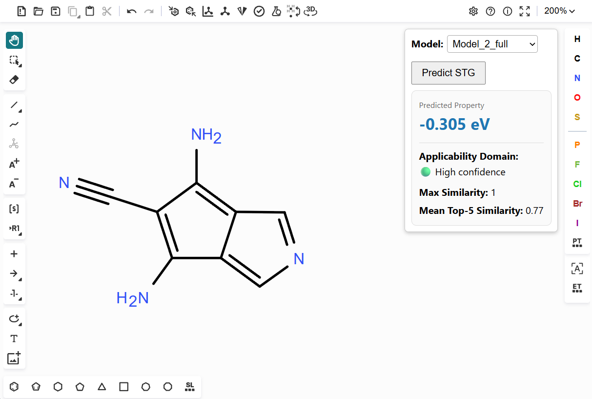

# ketcher-predict 

A modified Ketcher molecular editor with custom ML backend for molecular property prediction. Currently, the backend predicts the singlet-triplet gap (STG). The web application can be accessed [here](http://ketcher-predict.ttk.hu).

## STG Prediction

The methodology for STG prediction is published in our [paper](https://chemrxiv.org/doi/full/10.26434/chemrxiv.15008084) "Prediction of Singlet-Triplet Gaps Using Self-Attention–Based Regression with Model Integration into a Molecular Editor". 

The editor uses two of the ML models which were determined to perform best in the paper. Model_2 is an implementation of the AttentiveFP graph-based model, while Model_6b is a custom GNN-transformer hybrid. The models were trained on [data](https://doi.org/10.1016/j.matt.2024.01.002) calculated with the ADC(2) electronic structure method. 

The prediction model can be chosen from the drop-down menu in the prediction box of the interface. The demo versions of the models are the same those used in the paper where we have evaluated their learning performance. The `Model_2_full` option is the deployment version of the best model that should be used for actual predictions. It corresponds to a version of Model_2 that has been retrained on the entire INVEST dataset augmented with the external dataset containing original ADC(2) calculated STG values.

The interface also provides a feedback about the applicability domain which is based on the maximum tanimoto similarity of the molecule drawn on the canvas relative to the training set. As `Model_2_full` uses an extended training set, more molecule types (e.g., heptazines, molecules with O atoms) are predicted with larger confidence.

> Note that the INVEST dataset only contains C,N,H atoms meaning that the models are not expected to perform well for molecules containing other atoms.

The main Jupyter notebook in the `STG_predictor` folder contains code for reproducibility: model definitions, hyperparameter optimization (HPO), cross-validation (CV), oneshot prediction, etc. The final figures and the outlier analysis can be found in the other notebooks.

Environment files for Conda are also included:
- `ml_env_cpu.yml` is for running notebooks on a windows PC
- `hybrid_model.yml` is the same env but for PCs with GPU
- `hybrid_model_script.yml` is the env we used for production runs (HPO, CV) on a Linux workstation

The saved model weights are stored in the Zenodo repository: 

## Running the App Locally

Running the application on a local PC is relatively simple and works under both Windows and Linux:
1) install Docker
2) clone/download the repository
3) get the saved model weights (`revised_weights.zip`) from [Zenodo](https://doi.org/10.5281/zenodo.22111315)
4) put the extracted model files `model2_trial_12.pt`, `model6b_trial_40.pt` and `model2_full_dataset.pt` in the backend folder
5) use a terminal to navigate to the downloaded folder
6) use `docker compose build` to build a docker image
7) then `docker compose up` to start a container
8) open http://localhost:8000/ in a browser

## Todo

We plan to keep improving the web server by updating Ketcher and adding new molecular properties to predict. We plan to stay at Ketcher version v2, since v3 added a macromolecules feature that the backend is not designed to utilize.

Present taks:
- The models provide predictions for molecules with other than C,N,H atoms. The applicability domain feature somewhat accounts for this, but an error/warning message for "unknown" elements might be necessary. 
